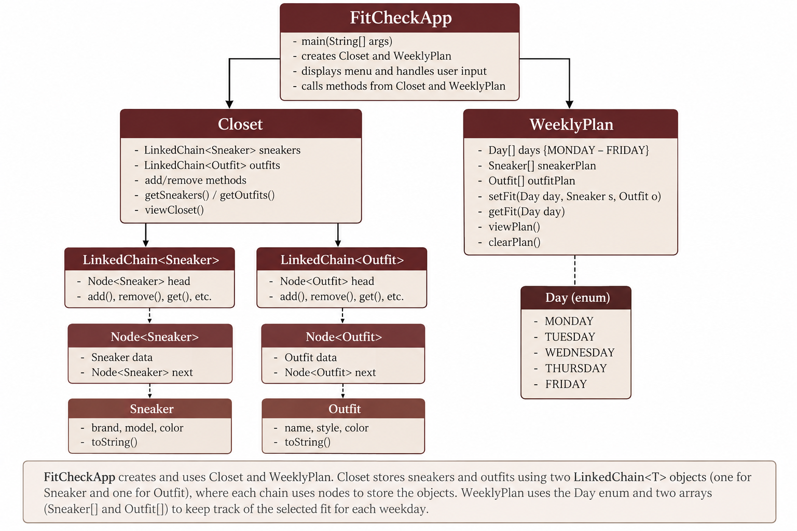

# FitCheck — Project 2 Final Build

FitCheck is a Java console application that helps users organize sneakers and outfits and plan what to wear Monday through Friday.

## Features

**Minimum viable product (MVP)**
- View a starter closet containing seven sneakers and seven outfits.
- Assign a sneaker and an outfit to a weekday.
- View the complete weekly plan.
- Replace a planned fit or clear a day.
- Handle invalid menu choices and nonnumeric input by prompting again.

**Final-build stretch goals**
- **Manage Closet:** add or remove sneakers and outfits through menu option 6.
- **Save and load:** persist the closet and weekly plan between application runs using a local `fitcheck-data.txt` file.

## How to compile and run

1. Install **Java 17** or a compatible newer JDK and open **Eclipse IDE**.
2. Import this repository as a Java project, or create a Java project and copy the `.java` files from `src/` into its source folder. The classes use the default package.
3. Make sure the project's JRE/JDK is configured.
4. Right-click `FitCheckApp.java` in Eclipse and select **Run As → Java Application**.
5. Use the numbered console menu:
   - `1` — View Closet
   - `2` — Build Weekly Plan
   - `3` — View Weekly Plan
   - `4` — Change Weekly Plan
   - `5` — Exit
   - `6` — Manage Closet (add/remove sneakers or outfits)

The application starts with the default closet if no valid saved data exists. With persistence enabled, it reads and writes `fitcheck-data.txt` in the program's working directory. This file is created when you make a saved change to the closet or plan. If you want to reset the closet to its original starter items, close the program and remove that save file.

## How to run the JUnit tests

1. In Eclipse, add **JUnit 5** to the project's Java Build Path (right-click project → **Build Path → Add Libraries → JUnit → JUnit 5**).
2. In the `src/` folder, run each of the following as **Run As → JUnit Test**, or select them together and run as a JUnit test:
   - `LinkedChainTest.java`
   - `SneakerTest.java`
   - `OutfitTest.java`
   - `ClosetTest.java`
   - `WeeklyPlanTest.java`
   - `FitCheckAppTest.java`
3. Inspect Eclipse's JUnit results for failures and errors. All tests should pass.

## System diagram

The diagram above is the team's supplied system overview. `FitCheckApp` controls console interaction and uses `Closet` and `WeeklyPlan`. `Closet` stores sneakers in `LinkedChain<Sneaker>` and outfits in `LinkedChain<Outfit>`, reusing the **same generic `LinkedChain<T>` implementation** for two element types. Each linked chain stores its items in nodes. `WeeklyPlan` uses the `Day` enum and the two arrays `Sneaker[] dailySneakers` and `Outfit[] dailyOutfits` to record daily selections. The diagram is conceptual; method labels in the source code may differ from the earlier specification.

## From specification to final build

**Deliverable 2 → Deliverable 3 (prototype):** We implemented the planned classes and console workflows, represented weekdays with a `Day` enum instead of raw strings, provided seven starter sneakers and seven starter outfits, and added JUnit 5 tests. We adapted the generic linked-chain implementation for the project's required operations.

**Deliverable 3 → Deliverable 4 (final):** We added user-driven closet management and a local save feature. This also required changing the valid main-menu range from 1–5 to 1–6 and updating/adding relevant tests.

**Challenges and learning:** The team had to coordinate class APIs, choose a generic collection contract before every use was known, handle invalid console input, and update tests as the interface changed. We learned that generics allow type-safe reuse of one implementation, while a stable public API allows classes to work together without accessing linked-list internals.

## File-by-file attribution

The assignments below reflect the team's previously documented primary responsibilities.

| File | Contributor(s) | Contribution and method |
|---|---|---|
| `LinkedChain.java` | Aidan | Adapted/reviewed the generic linked-chain implementation and its public API; built on course-provided material |
| `Node.java` | Aidan | Implemented/reviewed the linked-node structure |
| `LinkedChainTest.java` | Aidan | Wrote/reviewed tests for generic collection behavior |
| `Sneaker.java` | Asher | Implemented/reviewed sneaker model |
| `SneakerTest.java` | Asher | Wrote/reviewed sneaker tests |
| `Outfit.java` | Asher | Implemented/reviewed outfit model |
| `OutfitTest.java` | Asher | Wrote/reviewed outfit tests |
| `Closet.java` | Armaan | Implemented closet operations using `LinkedChain<Sneaker>` and `LinkedChain<Outfit>` |
| `ClosetTest.java` | Armaan | Wrote/reviewed closet tests |
| `Day.java` | Armaan | Implemented weekday enum; GenAI-assisted design discussion was disclosed in project source |
| `WeeklyPlan.java` | Armaan | Implemented and reviewed daily sneaker/outfit arrays and planning methods; GenAI-assisted enum design discussion |
| `WeeklyPlanTest.java` | Armaan | Wrote/reviewed weekly planner tests |
| `FitCheckApp.java` | Ari | Implemented/revised console UI, input handling and integration; GenAI-assisted suggestions for closet-management and save/load stretch goals, reviewed and manually tested in Eclipse |
| `FitCheckAppTest.java` | Ari | Implemented/revised console JUnit tests; GenAI-assisted test suggestions and menu-range updates |
| `README.md` | All members | Project instructions, documentation, attribution, and disclosure; team review required |
| `FitCheck-System-Diagram.png` | Team; GenAI-assisted diagram iteration | Final system diagram supplied for the presentation and README; team review required |

## GenAI use and ethics reflection

The team used GenAI tools as assistance, not as a substitute for understanding or reviewing the program. ChatGPT was used for debugging guidance, integration discussions, suggestions for JUnit tests, and save/load code for the stretch goal. Some team members also used Claude for design decisions, debugging, and implementation/test suggestions, as described in their own disclosures. The suggested tests and application changes were reviewed in Eclipse and the new menu behavior was exercised manually by all team members.

Over-reliance could leave hidden bugs or cause a teammate to present code they cannot explain. Next time, the team would use GenAI earlier in planning to compare possible approaches and anticipate integration issues, while continuing to check code and behavior independently.
